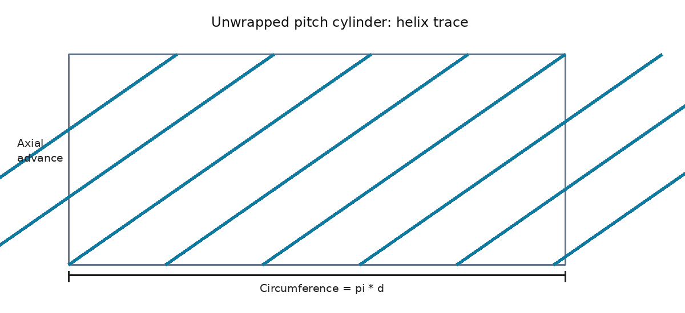
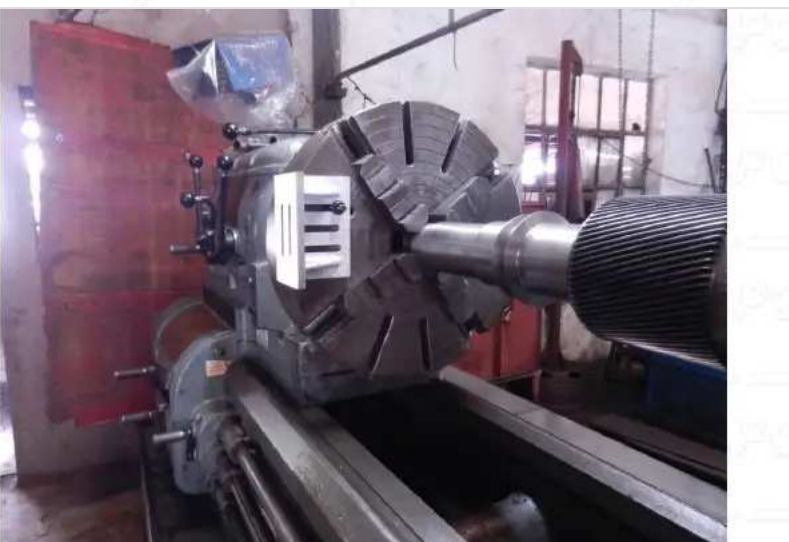
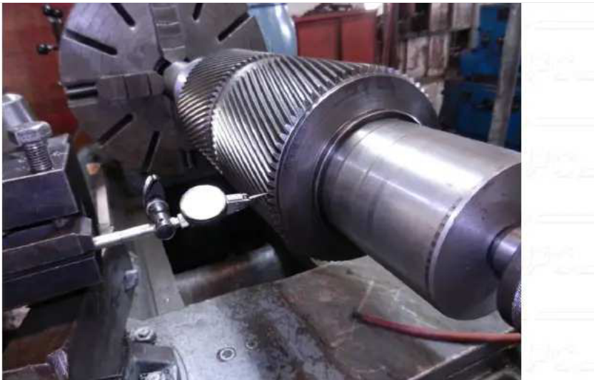
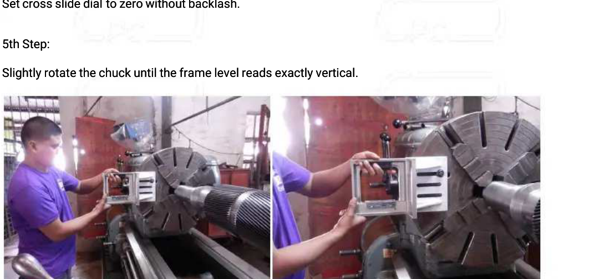
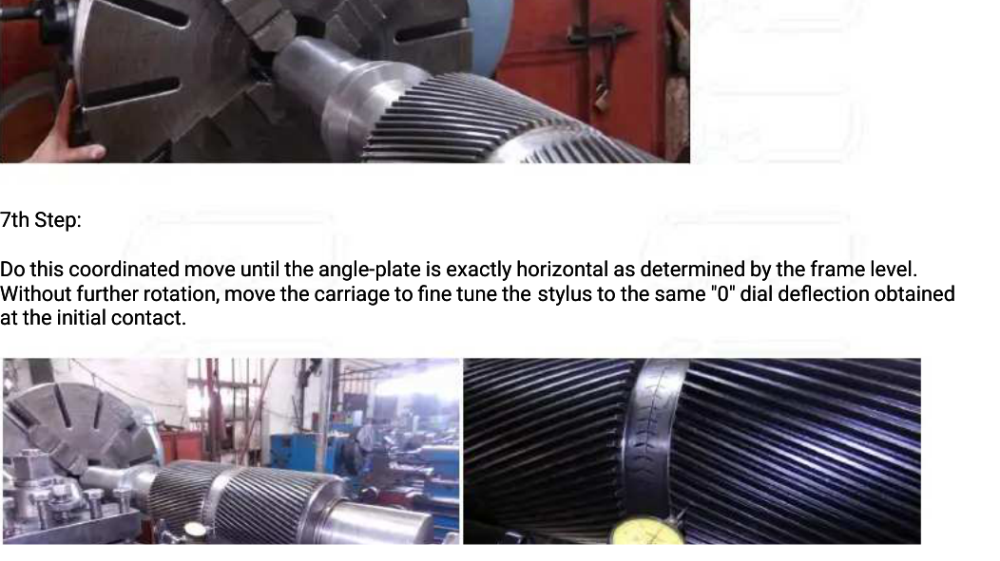
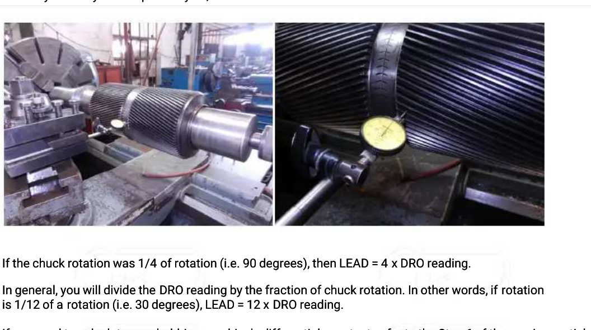
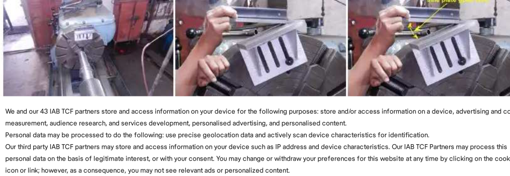

# راهنمای عملی اندازه‌گیری زاویه مارپیچ چرخ‌دنده با ابزار کارگاهی

> **موضوع:** اندازه‌گیری Helix Angle از طریق Lead (پیشروی مارپیچ)، بدون CMM و اسکن اپتیکی  
> **مبنای اصلی:** مقاله «Determining the Lead of a Large Gear with Precision»، فایل ارسالی Lead mes.pdf، صفحات ۱ تا ۶.  
> **نوع چرخ‌دنده:** چرخ‌دنده استوانه‌ای مارپیچ خارجی. این روش برای چرخ‌دنده مخروطی و Face Gear بدون اصلاحات هندسی قابل تعمیم نیست.

## ۱. مفهوم زاویه مارپیچ و لید

زاویه مارپیچ (β) زاویه بین مسیر دندانه روی **استوانه گام** و امتداد محور دوران چرخ‌دنده است. لید (Lead یا L) مقدار پیشروی **محوری** یک شیار یا پهلوی دندانه در یک دور کامل (۳۶۰ درجه) حول محور است. بر خلاف مشاهده زاویه روی قطر خارجی، لید یک مشخصه هندسی مناسب برای اندازه‌گیری غیرمستقیم زاویه مارپیچ است. برای چرخ‌دنده استوانه‌ای با مارپیچ ایده‌آل، رابطه به این صورت است:

tan(β) = π × d / L
β = arctan(π × d / L)
L = π × d / tan(β)

**نکته تعیین‌کننده:** در این روابط، d **قطر دایره گام (Reference/Pitch Diameter)** است، نه قطر سر دندانه. اگر فقط قطر سر دندانه معلوم باشد، باید ابتدا قطر گام را از مدول، تعداد دندانه و زاویه مارپیچ یا از اطلاعات طراحی استخراج کرد. انتخاب قطر اشتباه، زاویه محاسبه‌شده را تغییر می‌دهد.

*شکل مفهومی: مسیر دندانه روی استوانه گام را می‌توان مانند یک خط مورب بر سطح بازشده استوانه تصور کرد. شکل ترسیمی آموزشی است و از PDF اصلی استخراج نشده است.*

## ۲. وسایل موردنیاز

- دستگاه تراش با امکان نصب هم‌محور چرخ‌دنده و حرکت طولی دقیق سوپرت.
- **ورنیه طولی دستگاه تراش** با دقت و امکان قرائت مناسب جابه‌جایی سوپرت.
- ساعت اندیکاتور با نوک کروی؛ پایه مناسب روی سوپرت عرضی.
- **تراز دیجیتال** که روی قطعه‌ای محکم و هم‌دور با سه‌نظام نصب می‌شود تا اختلاف زاویه دوران از ابتدا تا انتهای حرکت خوانده شود.
- صفحه گونیا یا صفحه زاویه دقیق (Precision Angle Plate)، در صورت نیاز، فقط برای ایجاد سطح نصب مناسب تراز دیجیتال.
- برای قطعات کم‌عرض نیز همین روش با زاویه چرخش کوچک‌تر قابل اجراست.
- ابزار بستن مطمئن، فیکسچر و در صورت نیاز مرغک برای جلوگیری از خمش و لقی.

*تصویر ۱ ـ نمونه نصب چرخ‌دنده روی تراش، از صفحه ۲ منبع اصلی.*

## ۳. روش اصلی: دنبال‌کردن یک پهلوی دندانه هنگام چرخش معلوم

**گام ۱ ـ نصب و هم‌راستاسازی.** چرخ‌دنده را روی محور تراش ببند. موازی‌بودن محور چرخ‌دنده با راستای حرکت سوپرت، لنگی قطعه و استحکام بست را بررسی کن. دستگاه باید کاملاً خاموش باشد؛ در تمام فرایند فقط سه‌نظام را دستی بچرخان.

**گام ۲ ـ نصب مرجع زاویه.** تراز دیجیتال را روی صفحه‌ای محکم، هم‌دور با سه‌نظام و با وضعیت ثابت نصب کن. در آغاز، قرائت زاویه را ثبت یا دستگاه را صفر نسبی کن. در این روش **زاویه چرخش از قبل تعیین نمی‌شود**؛ مقدار واقعی آن در پایان ثبت خواهد شد. توجه کن که تراز دیجیتال باید تغییر زاویه دوران موردنظر را در دامنه مجاز خود درست نمایش دهد.

**گام ۳ ـ تنظیم اندیکاتور.** نوک کروی اندیکاتور را نزدیک ارتفاع میانی پهلوی یک دندانه، نه لبه نوک یا کف شیار، قرار بده. شرایط تماس باید در ابتدا و انتهای اندازه‌گیری یکسان باشند. ترجیحاً روی همان پهلو و همان قسمت کاری دندانه تماس بگیر.

*تصویر ۲ ـ جانمایی نوک ساعت اندیکاتور روی پهلوی دندانه، صفحه ۳.*

**گام ۴ ـ تنظیم صفر.** تراز دیجیتال را در وضعیت اولیه صفر نسبی کن یا عدد اولیه آن را یادداشت کن؛ قرائت ساعت اندیکاتور و ورنیه طولی را نیز صفر یا ثبت کن. برای پیشگیری از خطای لقی، حرکت نهایی سوپرت ترجیحاً همیشه از یک جهت باشد.

*تصویر ۳ ـ استفاده از تراز و صفحه زاویه دقیق، صفحه ۳.*

**گام ۵ ـ حرکت هماهنگ.** سه‌نظام را **با دست** به‌آرامی بچرخان و هم‌زمان سوپرت را در راستای محور حرکت بده؛ به گونه‌ای که نوک اندیکاتور همان شیار یا همان پهلوی دندانه را دنبال کند و عقربه نزدیک صفر اولیه بماند. **زاویه هدف مشخصی لازم نیست.** تا جایی که عرض دندانه و کورس ابزار اجازه می‌دهد حرکت کن و از برخورد ناگهانی نوک ساعت با دندانه جلوگیری کن. در طول حرکت ساپورت طولی باید با چرخش همزمان سه نظام ساعت را روی صفر نگاه داریم.

*تصویر ۴ ـ چرخش کنترل‌شده با صفحه زاویه، صفحه ۴.*

**گام ۶ ـ قرائت نهایی.** در انتهای حرکت طولی، اگر عقربه ساعت اندیکاتور دقیقاً روی صفر اولیه نیست، **با چرخاندن جزئی سه‌نظام به‌صورت دستی** آن را به همان قرائت اولیه برگردان؛ برای این اصلاح، ورنیه طولی را حرکت نده. سپس **زاویه واقعی چرخش** را از تراز دیجیتال به‌صورت Δθ و **جابه‌جایی واقعی محور طولی** را از ورنیه طولی به‌صورت ΔZ ثبت کن. مرجع قرائت زاویه باید همان وضعیت شروع باشد و هر دو قرائت پس از صفر شدن اندیکاتور انجام شوند.

*تصویر ۵ ـ بازگرداندن قرائت اندیکاتور به صفر اولیه، صفحه ۵.*

**گام ۷ ـ محاسبه لید.** چون در یک دور کامل ۳۶۰ درجه پیشروی محوری برابر L است، با استفاده از **زاویه واقعی نهایی** (Δθ) و جابه‌جایی محوری (ΔZ) محاسبه کن:

- L = 360 × |ΔZ| / |Δθ|

در این رابطه Δθ برحسب درجه است و باید زاویه **تجمعی واقعی دوران** باشد، نه زاویه ظاهری یا قرائت نادرست ناشی از عبور از محدوده اندازه‌گیری تراز. هیچ ضریب ثابتی مثل ۴ لازم نیست؛ ضریب از زاویه ثبت‌شده به دست می‌آید.

**گام ۸ ـ محاسبه زاویه مارپیچ.** پس از تعیین قطر گام d، مقدار β = arctan(π × d / L) را حساب کن. تابع arctan در ماشین‌حساب باید نتیجه را بر حسب **درجه** ارائه دهد. جهت مارپیچ (راست‌گرد یا چپ‌گرد) را جداگانه ثبت کن؛ این روابط قدر مطلق زاویه را می‌دهند.

## ۴. اگر عرض چرخ‌دنده کم باشد

مقاله تصریح می‌کند که برای چرخ‌دنده کم‌عرض باید زاویه چرخش را کاهش داد و در روش اصلی از صفحه سینوسی و تراز دقیق استفاده می‌کند. **در روش اصلاح‌شده با تراز دیجیتال، زاویه مشخصی را انتخاب نکن:** به اندازه‌ای حرکت کن که پهلوی دندانه و اندیکاتور در محدوده مطمئن باقی بمانند، سپس ساعت را با چرخاندن جزئی سه‌نظام صفر کن و زاویه واقعی نهایی را بخوان. هرچه جابه‌جایی محوری کوتاه‌تر باشد، خطای نسبی اندازه‌گیری بیشتر می‌شود؛ بنابراین بزرگ‌ترین حرکت **ممکن و ایمن** در طول دندانه بهتر است.

*تصویر ۶ ـ کاربرد صفحه سینوسی برای قطعات کم‌عرض، صفحه ۵.*

## ۵. نمونه عددی از مقاله اصلی

در مثال **خود مقاله اصلی**، چرخ‌دنده ۳۲ دندانه، زاویه مارپیچ اسمی ۳۰ درجه و گام قطری نرمال ۸ دندانه بر اینچ دارد. لید نظری آن **25.132741 اینچ** گزارش شده است. نویسنده برای سادگی محاسبه، چرخش ۹۰ درجه را انتخاب کرده و جابه‌جایی محوری متناظر را **6.283185 اینچ** نوشته است؛ بنابراین L = 360 × 6.283185 / 90 = 25.132740 inch. این مقدار ۹۰ درجه **فقط مربوط به مثال تاریخی منبع است**؛ در روش تو هر زاویه واقعی ثبت‌شده با تراز دیجیتال در فرمول عمومی جای‌گذاری می‌شود. این مثال **داده واقعی چرخ‌دنده شما نیست**.

## ۶. فرم ثبت اندازه‌گیری

| ردیف | پهلوی دندانه / محل تماس | زاویه چرخش (درجه) | جابه‌جایی محوری ΔZ (mm) | لید L (mm) | قطر گام d (mm) | زاویه β (درجه) |
|---|---|---:|---:|---:|---:|---:|
| ۱ | | | | | | |
| ۲ | | | | | | |
| ۳ | | | | | | |

پس از ثبت چند تکرار، میانگین لید و پراکندگی نتایج را بررسی کن. در صورت وجود سایش، ترجیحاً پهلوی کم‌سایش و چند دندانه با فاصله زاویه‌ای از یکدیگر را بررسی کن. این پیشنهاد تکمیلی برای افزایش قابلیت اطمینان است و جزء مراحل عددگذاری اصلی مقاله نیست.

## ۷. عوامل اصلی خطا و توصیه‌های عملی

۱. ناهم‌محوری محور چرخ‌دنده و خط حرکت سوپرت، نتیجه را منحرف می‌کند. ۲. خطای قرائت تراز دیجیتال، جابه‌جایی یا لغزش آن روی سه‌نظام و تغییر مرجع صفر زاویه مستقیماً به خطای لید تبدیل می‌شود. ۳. حرکت معکوس سوپرت و لقی پیچ می‌تواند قرائت ورنیه طولی را دچار خطا کند. ۴. تغییر محل تماس اندیکاتور روی پهلوی دندانه بین شروع و پایان موجب اختلاف می‌شود. ۵. در چرخ‌دنده‌هایی با اصلاح لید، تاج‌دارکردن یا سایش نامتقارن، اعداد به‌دست‌آمده ممکن است لید موضعی باشند. ۶. اگر در حین حرکت نوک اندیکاتور از دندانه جدا شد یا به آن ضربه خورد، اندازه‌گیری را از ابتدا انجام بده.

## ۸. روش‌های جایگزین برای کارگاه کوچک

**روش فرز و کله‌تقسیم:** با یک کله‌تقسیم دقیق و حرکت طولی میز فرز، همان پهلو دنبال می‌شود؛ مقاله رایگان August Lehman با عنوان *Determining the Differential Constant of a Gear Hobber with Precision* این روش را توضیح می‌دهد، هرچند در روش آن اتصال مکانیکی و چرخ‌دنده‌های تعویضی لازم می‌شود. [مطالعه آزاد مقاله](https://meshingwithgears.us/article_7a.html).

**روش اثرگذاری دندانه روی کاغذ:** سطح سر دندانه را رنگی کن و چرخ‌دنده را به صورت خطی روی کاغذ بغلتان تا جهت دندانه‌ها منتقل شود. زاویه اثر را می‌توان با نقاله تخمین زد. به خاطر داشته باش این زاویه در **قطر سر دندانه** به‌دست می‌آید، نه مستقیماً در قطر گام؛ لازم است اثر تغییر شعاع با هندسه مارپیچ تصحیح شود. [مقاله آزاد درباره تعیین هندسه ناشناخته چرخ‌دنده](https://gearsolutions.com/features/a-procedure-to-determine-the-unknown-geometry-of-external-cylindrical-gears/).

**روش نقاله/زاویه‌سنج:** برای تخمین سریع راستا و اندازه زاویه دندانه مناسب است، ولی به‌علت انحنای محیط چرخ‌دنده و دشواری دسترسی به مماس صحیح، جایگزین اندازه‌گیری دقیق لید نیست. [راهنمای رایگان Rapid Gear](https://rapidgear.com/gear-measurement-guide-for-off-site-applications/).

## ۹. منابع رایگان تکمیلی

| منبع آزاد | کاربرد | پیوند |
|---|---|---|
| August Lehman — *Determining the Differential Constant of a Gear Hobber with Precision* | اندازه‌گیری لید با فرز، کله‌تقسیم و ساعت اندیکاتور | [متن کامل](https://meshingwithgears.us/article_7a.html) |
| *A Procedure to Determine the Unknown Geometry of External Cylindrical Gears* — Gear Solutions | تخمین زاویه مارپیچ در قطر سر دندانه از رد دندانه روی کاغذ | [متن کامل](https://gearsolutions.com/features/a-procedure-to-determine-the-unknown-geometry-of-external-cylindrical-gears/) |
| *Gear Measurement Guide for Off-Site Applications* — Rapid Gear | روش ساده کارگاهی با نقاله | [متن کامل](https://rapidgear.com/gear-measurement-guide-for-off-site-applications/) |
| *Precise Measurement of Involute Spline Pressure Angle and Helical Gear Helix Angle* — ZHY Gear | اندازه‌گیری لید با دستگاه سنگ‌زنی دقیق و ساعت اندیکاتور | [متن کامل](https://www.zhygear.com/precise-measurement-of-involute-spline-pressure-angle-and-helical-gear-helix-angle/) |
| *Lead or Helix? That is the Question* — Gear Solutions | تعریف لید، زاویه مارپیچ و اختلاف علامت خطا | [متن کامل](https://gearsolutions.com/features/lead-or-helix-that-is-the-question/) |

**توجه:** این پنج منبع به‌صورت متن کامل قابل مطالعه رایگان در وب‌اند، اما لزوماً نسخه PDF قابل دانلود مستقل ندارند. عکس‌های آموزشی این جزوه از فایل PDF ارسالی شما استخراج شده‌اند. شکل هندسی آغاز جزوه مستقل تهیه شده است. منابع وب، مطالب تکمیلی هستند و نباید با محتوای منبع اصلی یکی در نظر گرفته شوند.
